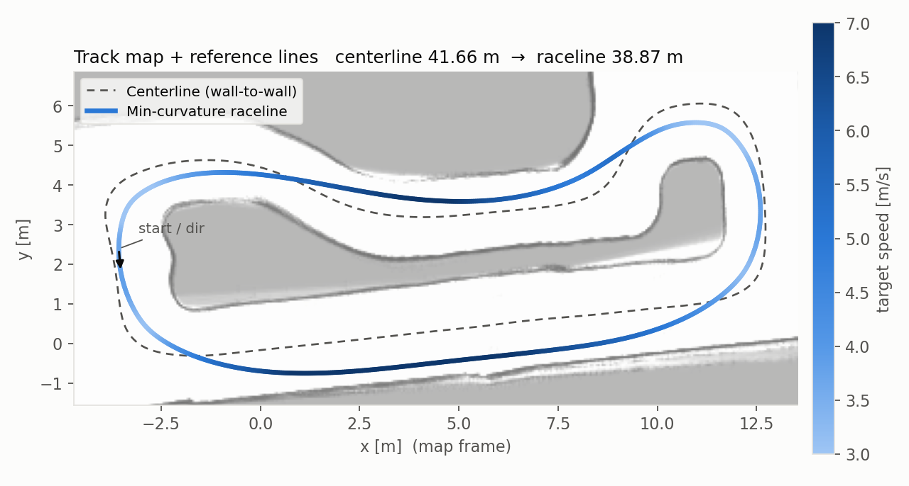
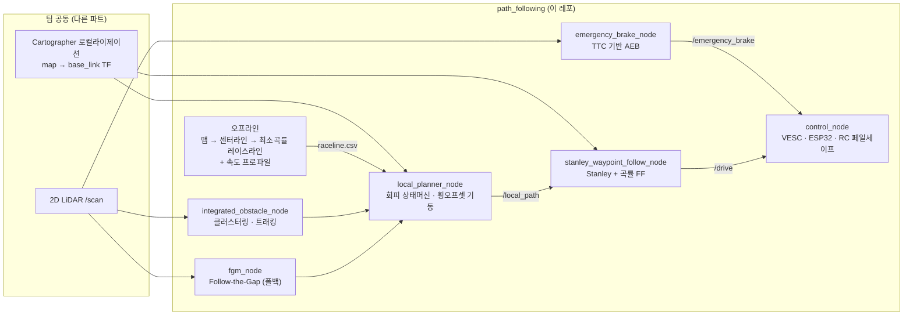
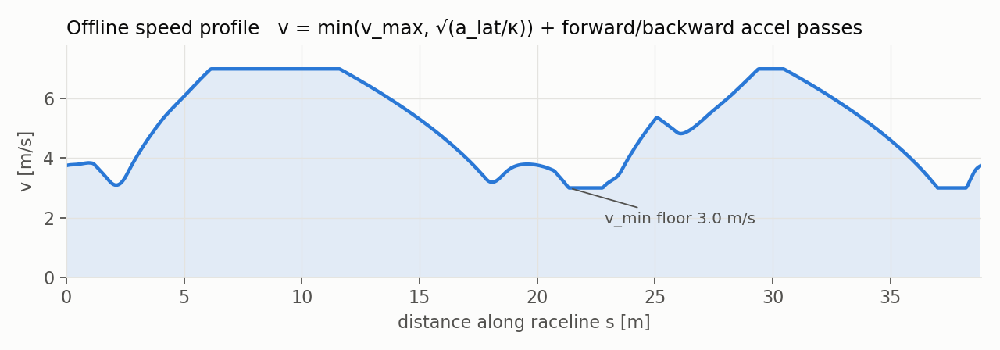
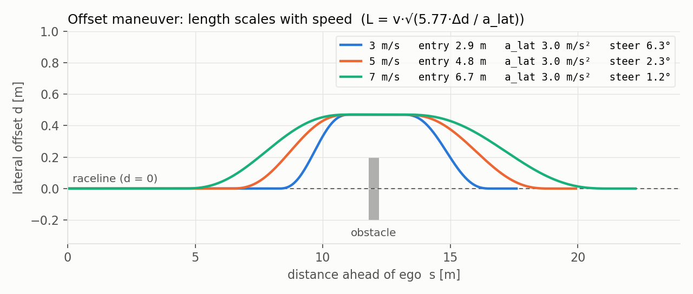

# RoboRacer 2026 — Path Following

**1/10 스케일 자율주행 레이싱카의 경로 생성 · 경로 추종 · 장애물 회피 스택** (ROS 2 Humble, Jetson Orin NX 실차)

[](https://github.com/wowowowooon/Roboracer-2026/actions/workflows/tests.yml)

<p align="center">
  
</p>

| | |
|---|---|
| **프로젝트** | 아주대학교 RoboRacer(구 F1TENTH) 팀 — 1/10 스케일 자율주행 레이싱 |
| **기간** | 2026.07 – 2026.08 (실차 개발·튜닝) |
| **플랫폼** | Jetson Orin NX · 2D LiDAR · IMU · VESC(구동) · ESP32(조향 서보) |
| **스택** | ROS 2 Humble · Python · NumPy/SciPy · Cartographer(로컬라이제이션) |
| **내 역할** | **Path Following 파트 담당** — 레이스라인 생성, Stanley 추종, 회피 계획, AEB, 주행 로깅 |

> 이 레포는 팀 전체 코드 중 **제가 담당한 `path_following` 패키지만** 정리한 포트폴리오입니다.
> 센서·로컬라이제이션 등 나머지 계층은 팀 레포 [Roboracer-AJOU/jetson_code](https://github.com/Roboracer-AJOU/jetson_code)에 있습니다.
> `path_following`은 팀원 조은재와 함께 개발했고, 공동 작업 내역은 커밋 기록에 그대로 남아 있습니다.

---

## 시스템 구조



| 노드 | 역할 |
|---|---|
| `local_planner_node` | 레이스라인 ↔ 회피 경로 전환 상태머신 (`GLOBAL` / `AVOID` / `REJOIN` / `TRAILING`) |
| `stanley_waypoint_follow_node` | Stanley 횡제어 + 곡률 피드포워드, 접지력 예산 기반 조향 제한 |
| `integrated_obstacle_node` | LiDAR 클러스터링, 칼만 필터 트래킹, 맵 벽 제거 |
| `fgm_node` | Follow-the-Gap. 계획 기동이 실패했을 때의 폴백 |
| `emergency_brake_node` | 플래너와 독립된 TTC 기반 비상 제동 + 후진 탈출 |
| `control_node` | `/drive` → VESC 듀티 / ESP32 조향, ESTOP·RC 수동 전환 |

---

## 핵심 구현

### 1. 맵 → 레이스라인 → 속도 프로파일 (오프라인)

Cartographer 점유 격자에서 **스켈레톤 + 거리변환**으로 벽-벽 중앙 센터라인을 뽑고,
그 위에서 **최소곡률 레이스라인**을 볼록 QP로 풉니다.

라인을 `x_i = p_i + α_i·n_i` (센터라인 + 법선 오프셋)로 두면 2차차분이 `α`에 대해 아핀이 되어,

```
min  Σ ‖x_{i-1} − 2x_i + x_{i+1}‖²     s.t.  lo_i ≤ α_i ≤ hi_i
```

가 박스 제약 QP가 됩니다. `lo/hi`는 각 점에서 법선 방향으로 벽까지 레이캐스팅한 거리에서
차폭 여유를 뺀 값이라 **해가 트랙 밖으로 나갈 수 없습니다.** 해를 다시 기준선으로 삼아 재선형화합니다.

속도는 주행 중 "코너 감지" 없이, 곡률과 가감속 한계만으로 미리 정합니다.

```
1) 곡률 한계   v_i = min(v_max, √(a_lat / κ_i))
2) 역방향 패스 v_i = min(v_i, √(v_{i+1}² + 2·a_brake·ds))   ← 브레이킹 포인트
3) 정방향 패스 v_i = min(v_i, √(v_{i-1}² + 2·a_accel·ds))   ← 코너 탈출 가속
```

<p align="center"></p>

현재 트랙(`maps/cartographer_map_20260822_193736`)에서 `generate_raceline_from_centerline.py` 실행 결과:

| | 센터라인 | **최소곡률 레이스라인** |
|---|---|---|
| 길이 | 41.66 m | **38.87 m** |
| 예상 랩타임 (속도 프로파일 모델) | 9.88 s | **8.28 s** (−16%) |
| 최소 벽 여유 | — | 0.339 m |
| 벽 관통 / 자기교차 | — | 0 / 0 |

> 랩타임은 속도 프로파일로 계산한 **모델 예측값**이고, 실차 랩타임 측정값이 아닙니다.

### 2. Stanley 경로 추종

전륜축 기준 Stanley 제어에 곡률 피드포워드를 더했습니다.

```
δ = w_h(v, e)·ψ_e + atan(k·e / (v + v_soft)) + δ_ff,    δ_ff = g_ff · atan(L·κ_ahead)
```

- **헤딩항 가중 `w_h`**: CTE가 클 때 헤딩항이 복귀를 방해하면 줄이고, 둘이 같은 방향이면 그대로 둡니다.
- **접지력 예산**: 피드백 조향이 요구하는 횡가속을 `feedback_lateral_accel_mps2`로 제한해 고속에서 조향 포화로 미끄러지지 않게 합니다.
- 회피 경로(`LOCAL_PATH`)에서는 별도 게인과 lookahead 헤딩을 써서 계획한 곡선을 강하게 따라갑니다.

### 3. 장애물 회피 — 속도가 길이를 정하는 횡오프셋 기동

처음에는 FGM 목표점까지 직선, 또는 고정 길이(1.2 m) Frenet 곡선으로 피했습니다.
**6 m/s에서 횡가속 94 m/s²를 요구하는 경로**였고, 차는 조향을 꺾은 채 벽으로 갔습니다.

해결: 회피 길이를 **횡가속 예산에서 역산**합니다. 5차 다항식 `d(s)`의 최대 `|d''|`는 `5.77·Δd/L²`이므로

```
a_lat ≈ v² · 5.77 · Δd / L²   →   L = v · √(5.77 · Δd / a_lat)
```

<p align="center"></p>

같은 장애물이라도 7 m/s에서는 더 멀리서 완만하게 틀어서, 횡가속은 3.0 m/s²로 같고 조향은 1.2°에 그칩니다.
위 그림은 `offset_maneuver.plan_maneuver()`를 그대로 호출해 그렸습니다 ([tools/make_figures.py](tools/make_figures.py)).

기동 계획에서 신경 쓴 것:

- **벽 예산(좌/우 분리)**: 맵에서 레이스라인 각 점의 좌·우 여유를 미리 깔아 두고, 벽 쪽 계획은 아예 만들지 않습니다.
  레이스라인은 코너 안쪽에 붙어 있어서 "덜 움직이는 쪽"이 곧 벽인 경우가 많았습니다.
- **트랙에 안 들어가면 속도를 낮춰 재계획**: 길이가 `v`에 비례하므로 반대편 → 감속 순으로 다시 뽑습니다.
- **코너 곡률 반영**: 기준선이 이미 쓰고 있는 `v²κ`를 예산에서 먼저 뺍니다.
- **커밋**: 한 번 그린 기동은 붙들고, 장애물이 바뀌거나 크게 벗어났을 때만 다시 그립니다.
- **실패 시 폴백**: 기동이 실패하면 FGM → 감속/`TRAILING`(앞차 추종) 순으로 내려갑니다.

현재 트랙의 레이스라인 777개 지점 전부에 정면 장애물을 놓고 잰 결과 (`scripts/check_offset_budget.py`):

| 결과 | 비율 |
|---|---|
| 풀속도로 기동 성공 | 61% |
| 감속 후 기동 성공 (목표속도 중앙값 4.0 m/s) | 28% |
| 계획 거부 → 감속 / TRAILING | 4% |
| FGM 폴백 | 8% |
| **벽으로 나가는 계획** | **0건** |

### 4. 안전 계층 — AEB와 탈출

- `emergency_brake_node`는 플래너와 **독립적으로** `/scan`과 실측 속도만으로 iTTC(`r / (v·cosθ)`)를 계산해 제동합니다.
- 정지 후에는 재발동 방지 창을 두고 탈출 경로로 빠져나가며, 코앞이 막혀 있으면 0.2 m씩 끊어 후진합니다.
- LiDAR가 뒤를 보지 못하므로 후진 시 충돌 판정은 맵으로 합니다.

---

## 트러블슈팅 기록

실차에서 겪은 문제와 원인을 개발 노트에 남겼습니다. 몇 가지 예시:

| 증상 | 원인 | 해결 |
|---|---|---|
| 고속 회피 중 조향을 문 채 벽 충돌 | 회피 경로 길이가 고정 → 속도² 로 횡가속 폭증 | 횡가속 예산으로 길이 역산 (`offset_maneuver.py`) |
| 회피하던 방향의 벽에 충돌 | 오프셋 상한 0.70 m 고정, 실제 레이스라인→벽 최소 여유는 0.30 m | 좌/우 벽 예산을 맵에서 계산 (`_build_wall_budget`) |
| 복귀 중 라인을 지나쳐 바깥 벽으로 | 기준선을 직선으로 가정해 코너의 `v²κ` 를 예산에 안 넣음 | `kappa_ref`로 코너 곡률을 예산에서 선차감 |
| 수직에 가까운 헤딩에서 복귀 실패 | Frenet 투영이 헤딩오차를 45°로 잘못 계산 | 한계 초과 시 복귀 대신 정렬 경로 (`_build_alignment_path`) |
| 직선 끝에서 장애물에 2.0 m/s로 도달 | 검출 거리 7.5 m에서 속도 상한이 계단식으로 떨어짐 | 진입 거리 12 m로 확대 + 3 m/s² slew |

전체 기록(설계 근거, 실측값, 파라미터 표): **[src/path_following/README.md](src/path_following/README.md)**

---

## 검증

`offset_maneuver.py`, `obstacle_filter.py`, `track_kf.py` 같은 핵심 계산은 ROS 의존 없는 순수 모듈로 분리했고,
노드는 메시지 스텁으로 감싸 **단위 테스트 501개**로 물리·기하 조건을 고정했습니다.

```
497 passed, 4 xfailed
```

xfail 4개는 실차 튜닝/롤백 이후 기준값이 아직 갱신되지 않은 알려진 항목이고, 사유를 테스트에 적어 두었습니다.

```bash
source /opt/ros/humble/setup.bash
cd src/path_following && python3 -m pytest -q test
```

---

## 레포 구조

```
.
├── src/path_following/         # ROS 2 패키지 (ament_python)
│   ├── path_following/         #   노드 + 순수 계산 모듈
│   ├── launch/                 #   주행 스택 런치
│   ├── config/                 #   centerline.csv, raceline.csv (x, y, v)
│   ├── scripts/                #   센터라인 추출, 레이스라인 생성, 검증 도구
│   ├── test/                   #   단위 테스트
│   └── README.md               #   개발 노트 (원문)
├── maps/                       # 현재 트랙 Cartographer 맵 (png + yaml)
├── tools/make_figures.py       # README 그림 재생성
└── docs/images/
```

## 실행

```bash
# 빌드 (레포 루트 = colcon 워크스페이스)
source /opt/ros/humble/setup.bash
colcon build --packages-select path_following && source install/setup.bash

# 레이스라인 재생성 (maps/ 의 맵 사용)
cd src/path_following/scripts
python3 extract_centerline_from_map.py
python3 generate_raceline_from_centerline.py --v-ref 7.0

# 주행 스택 (로컬라이제이션 · 센서는 팀 레포에서 별도 실행)
ros2 launch path_following path_follow_static_dynamic_avoid_launch.py
```

> 실차용 코드라 일부 경로(`/home/nvidia/f1tenth_ajou/...`)와 하드웨어 설정이 젯슨 기준으로 들어가 있습니다.
